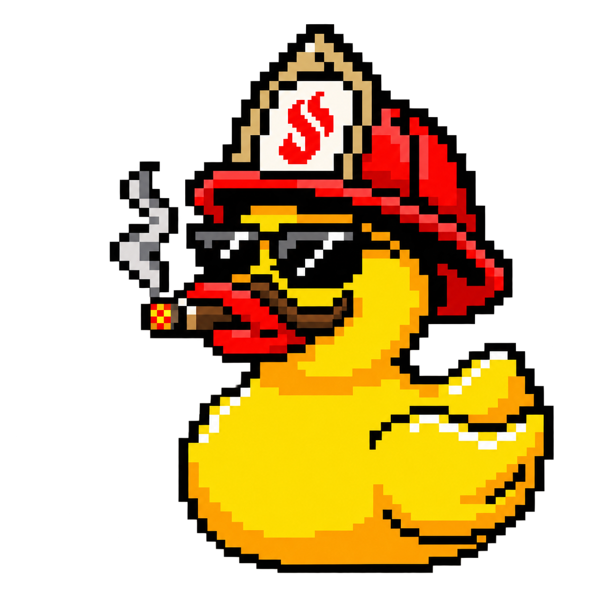
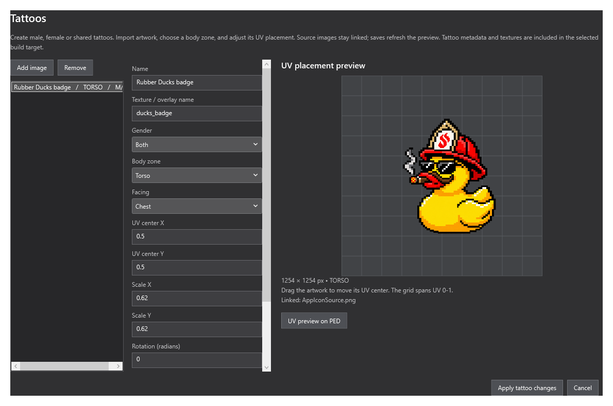
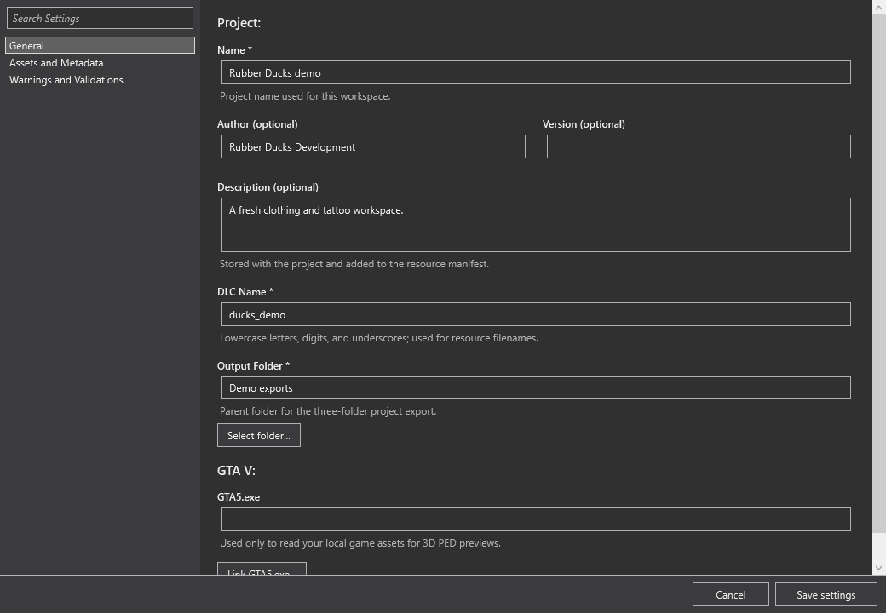

<p align="center">
  
</p>

<h1 align="center">Duck Studio</h1>

<p align="center">
  <b>Create, inspect and build GTA V clothing and tattoo packs.</b><br>
  A native Windows workspace for linked artwork, 3D previews, outfit checks and game-ready exports.<br>
  Free, open source, and maintained by Rubber Ducks Development.
</p>

<p align="center">
  
  
  
  
</p>

<p align="center">
  <a href="#get-started"><b>Get started</b></a> ·
  <a href="#screenshots">Screenshots</a> ·
  <a href="#features">Features</a> ·
  <a href="#file-support">File support</a> ·
  <a href="#build-from-source">Build from source</a> ·
  <a href="#documentation">Documentation</a>
</p>

> [!NOTE]
> **Downloads are public.** Get the installer or portable Windows package from [GitHub Releases](https://github.com/Rubber-Ducks-Development/duck-studios/releases/latest). Desktop fitting and tattoo previews are approximations; verify the result in your target game.

<p align="center">
  
  <br>
  <sub>The real tattoo editor with the supplied duck artwork and a demonstration collection. No game assets are bundled in this example.</sub>
</p>

<table>
  <tr>
    <td width="25%" valign="top"><h3>Clothing and textures</h3>Organize component and prop slots, import artwork, and keep source images linked.</td>
    <td width="25%" valign="top"><h3>Inspect and fit</h3>Review UVs, texture variations, outfits and fitting poses in the 3D tools.</td>
    <td width="25%" valign="top"><h3>Tattoos and artwork</h3>Place linked artwork, choose body zones and generate overlay/shop metadata.</td>
    <td width="25%" valign="top"><h3>Build and recover</h3>Validate packs, export to multiple targets, and keep backups and revision history.</td>
  </tr>
</table>

## Screenshots

<p align="center">
  
  <br>
  <sub>Project setup keeps the collection name, export folder and source settings together. Values shown are demonstration data.</sub>
</p>

These are captures of the application's actual WPF controls, rendered with an
isolated sample project. See [image sources](docs/images/SOURCES.md).

## Features

| Workflow | What you can do |
| --- | --- |
| Clothing collections | Import YDD models and YTD textures from files, folders or a FiveM resource. Work with male/female components and props across the supported GTA slots. |
| Linked artwork | Import PNG, JPG, PSD/PSB and other supported images. Saving source artwork refreshes generated textures and previews; unreadable saves retain the last good result. |
| 3D and UV inspection | Rotate and zoom the model, inspect variations, overlay UVs, use checker textures and locate a clicked surface. Full PED fitting uses your own GTA V installation. |
| Outfits and poses | Combine clothing and props, save outfit presets, hide layers to inspect clipping, and inspect procedural standing, walking, running, sitting and aiming poses. |
| Tattoo authoring | Choose gender, body zone, facing, UV position, scale and rotation. Export tattoo textures, overlays XML and shop metadata. |
| Editing and recovery | Undo/redo, batch operations, automatic backups, project history, independent asset snapshots and revision comparison. |
| Optimization | Review texture sizes, duplicates, triangle counts and LODs; apply conservative texture and mesh optimizations with the original assets preserved. |
| Build targets | FiveM resources, alt:V resources, single-player DLC archives or raw game assets, with a portable project and source assets. |
| Validation and presentation | Review build findings, export reports, create transparent product PNGs and contact sheets, and export the FiveM test companion. |

Read the [feature guide](Editor/FEATURES-2.1.md) for exact controls and behavior.

## Get started

**Requirements:** Windows x64. Official downloads include the .NET desktop runtime.
A local GTA V installation is required for full character fitting previews, not for
ordinary project editing or asset-only previews.

1. Open the [latest release](https://github.com/Rubber-Ducks-Development/duck-studios/releases/latest).
2. Use `DuckStudioSetup.exe` for a per-user installation, or extract
   `DuckStudio-Windows-<version>.zip` and run `DuckStudio.exe` inside that folder.
3. Keep the portable app's runtime files beside its executable.
4. Create a project with its name, collection/DLC name and output folder, then import assets.

| Download | Use it when |
| --- | --- |
| `DuckStudioSetup.exe` | You want a Start menu shortcut, uninstall entry and Open With support for project files. |
| `DuckStudio-Windows-<version>.zip` | You want a portable folder you can extract and run. |
| `SHA256SUMS.txt` | You want to compare the download's SHA256 with the published checksums. |

[All releases](https://github.com/Rubber-Ducks-Development/duck-studios/releases) include
earlier versions and their notes. Update to **2.1.2 or later** before opening projects
received from other people; see the [security policy](SECURITY.md).

## File support

| Type | Support and limits |
| --- | --- |
| `.duckproj` | Native editable workspace. Exported projects retain source assets and use relative links for portability. |
| `.dctproj` | Durty Cloth project import through an adjacent built FiveM resource. The original file is preserved; save imported work as `.duckproj`. |
| `.ydd` / `.ytd` | Clothing drawable dictionaries and texture dictionaries. Component and prop workflows are supported. |
| PNG, JPG, PSD, PSB and other images | Import artwork and linked texture variations. PSD/PSB use saved composite artwork; animated or multi-page files use the first frame. See the [image guide](Editor/README.md#linked-photos-and-photoshop-textures-12). |
| YLD and supplemental YMT | Optional source physics and metadata can accompany the build. The app does not author custom facial expressions or shader tracks. |
| FiveM / alt:V / single-player / raw | Select the build target for the required resource or archive layout. Game/server runtime validation remains a separate step. |

Studio 2.1.3 saves new projects, exports and recovery snapshots as `.duckproj`.
Legacy `.weftproj` and `.duck` projects still open. Saving a legacy file offers a
new `.duckproj` copy and leaves the original intact. Durty Cloth `.dctproj` import
uses its adjacent built FiveM resource; build it in Durty Cloth Tool first. Studio
does not write `.dctproj` files.

Desktop fitting uses procedural joint rotations and real skin weights, rather than
GTA animation clips or cloth physics. Tattoo preview uses a UV approximation. Review
clipping, decoration projection and animation in the target game or the exported
FiveM test companion. Generated LOD reduction depends on the mesh and its protected seams.

## Workflow

1. **Create the collection.** Set the project name, collection/DLC name and export folder.
2. **Import and organize.** Add clothing models and texture variations; choose gender, slot and position.
3. **Inspect the result.** Check textures, UVs, outfits, fitting poses and any tattoos.
4. **Validate and build.** Review errors and warnings, then select the target and folder/ZIP output.
5. **Test in the game.** Deploy the generated resource and verify the actual clothing and tattoo behavior.

For a FiveM build, the export groups the game resource, editable project and original
assets. Copy `FiveM/<collection>` to your server resources and add `ensure <collection>`.
The optional `duckstudio_test` companion is described in the
[feature guide](Editor/FEATURES-2.1.md#fivem-test-companion).

## Build from source

Use Windows x64 with the **.NET 10 SDK**. Packaging requires PowerShell 7. Rebuilding
the Rust renderer also requires a stable Rust toolchain and Windows C++ build tools.

```powershell
git clone https://github.com/Rubber-Ducks-Development/duck-studios.git
cd duck-studios
dotnet build Editor/WeftStudio.csproj -c Release
dotnet run --project Tests/DuckStudio.Tests.csproj -c Release
```

`Vendor/Runtime` holds the CodeWalker, SharpDX and renderer binaries used by release
packaging. To rebuild the renderer:

```powershell
cargo build --locked --release --manifest-path Renderer/Cargo.toml
Copy-Item Renderer/target/release/rage.exe Vendor/Runtime/rage.exe
```

| Folder | Purpose |
| --- | --- |
| `Editor/` | WPF editor, image import, previews and pack builder |
| `Installer/` | Per-user installation, update maintenance and uninstall handling |
| `Renderer/` | Modified rage-cli source |
| `Tests/` | Generated-fixture regression checks |
| `Vendor/Runtime/` and `Vendor/Licenses/` | Packaged dependencies and their notices |

Tests generate their own fixtures and do not need GTA V or private signing keys.
`DUCK_STUDIO_TEST_ROOT` selects another fixture directory. Maintainers should use
[RELEASING.md](RELEASING.md) for distributable builds rather than publishing loose build files.

## Updates and security

**Help > Check for updates** checks the signed stable feed. Automatic checks are on
by default at startup and every six hours; change them in **Help > Update settings**.
The app asks before installing and verifies the pinned RSA-PSS release signature,
installer size and SHA256. Redirects must remain on HTTPS. Saving/recovery and close
confirmation complete before installation starts.

New copies select the public GitHub feed automatically. On copies from 2.1.1 or
earlier, choose the public feed in Update settings or install the latest release
manually. Existing custom signed feed settings take precedence.

The release-feed signature is separate from a Windows publisher certificate. Current
EXEs do not carry an Authenticode publisher signature. Keep private keys outside the
repository; see [releasing](RELEASING.md) and [security](SECURITY.md) for the trust model,
private vulnerability reporting and review limits.

## Documentation

| Guide | Contents |
| --- | --- |
| [Editor guide](Editor/README.md) | Imports, export layout, linked artwork, recovery and detailed workflows |
| [Feature guide](Editor/FEATURES-2.1.md) | UV tools, outfits, fitting, batch edits, LODs and the FiveM companion |
| [Changelog](CHANGELOG.md) | Versioned changes |
| [Releasing](RELEASING.md) | Build, packaging, signing and publishing |
| [Security](SECURITY.md) | Private reporting and security controls |
| [Third-party notices](THIRD_PARTY.md) | Renderer and bundled dependency attribution |
| [README style](docs/README-STYLE.md) | Shared documentation format used across the app family |

## Rubber Ducks Development

Two companion workspaces with a shared visual language and different production jobs.

| App | What it is for | Workspace | Source and downloads |
| --- | --- | --- | --- |
| **Duck Studio** | Clothing collections, tattoos, outfits, texture workflows and pack builds | `.duckproj` | [Repository](https://github.com/Rubber-Ducks-Development/duck-studios) · [Releases](https://github.com/Rubber-Ducks-Development/duck-studios/releases) |
| **Duck Workshop** | Vehicle UVs, light patterns, warning textures, metadata and handling comparison | `.duckworkshop` | [Repository](https://github.com/Rubber-Ducks-Development/duckworkshop) · [Releases](https://github.com/Rubber-Ducks-Development/duckworkshop/releases) |

**Share images, keep projects separate.** Export a texture as PNG from Studio, inspect
or edit it in Workshop, then replace the image in Studio. Workshop's transparent
stripe PNGs can also be imported into Studio. The two workspace schemas are not
interchangeable; Workshop does not directly import clothing YDD/YTD packages.

## Contributing

Read [CONTRIBUTING.md](CONTRIBUTING.md), run the relevant build/tests and
`./Security-Checks.ps1`, and describe the workflow your change affects. Keep game
data, private keys and personal workspaces out of source control.

Use [bug reports](https://github.com/Rubber-Ducks-Development/duck-studios/issues/new?template=bug_report.yml)
for reproducible problems and [feature requests](https://github.com/Rubber-Ducks-Development/duck-studios/issues/new?template=feature_request.yml)
for a concrete workflow improvement. Include the app version and a minimal example
you have permission to share. Report vulnerabilities privately through [SECURITY.md](SECURITY.md).

## License and credits

The editor and installer use the [MIT license](LICENSE). The modified renderer
retains its [Unlicense](Renderer/LICENSE); bundled dependencies retain their own
licenses and notices in [THIRD_PARTY.md](THIRD_PARTY.md).

The pixel-art duck logo was supplied by the project owner. Screenshots use that
artwork and demonstration values, with [sources recorded here](docs/images/SOURCES.md).
GTA game data, recovered keys, private signing keys and user projects are not bundled.
Duck Studio is independent of Rockstar Games and FiveM.

<p align="center"><sub>Made by Rubber Ducks Development.</sub></p>
